# ChatGPT-Style Floating Selection Pen & Side-Panel Annotation Deck
**Universal Architectural Specification & Reusable Implementation Blueprint**
*Target Workspaces: Om Knowledge OS, ChatGPT Codex Workspaces, Antigravity Projects*
*Persistent Master Path: `C:\Users\adity\AG misc\CHATGPT_STYLE_SELECTION_ANNOTATION_DECK.md`*

---

## 1. Executive Summary & Architectural Rationale

This document establishes the universal design pattern, TypeScript contracts, DOM event math, and UI components for a **ChatGPT-Style Floating Selection Pen and Side-Panel Annotation Deck**.

### Why This Exists
In traditional note-taking and coding editors:
- Comments are either disconnected from the source text (buried in a separate chat) or require clunky modal workflows.
- Rich-format / preview modes are typically read-only, preventing users from directly annotating or typing into code blocks.
- `window.getSelection()` returns empty strings (`""`) on HTML `<textarea>` elements, breaking selection detection in text editors.
- Feeding user feedback back into Large Language Models (LLMs) requires manual copy-pasting of snippets, line numbers, and questions.

### The Solution: 5-Layer Autonomous Workflow
1. **Dual Selection Detection Engine**: Captures highlighted text in both raw `<textarea>` inputs (via `selectionStart`/`selectionEnd`) and rendered rich-format preview panes via `window.getSelection()`.
2. **Floating Action Pen**: Spawns an animated floating badge (`[✏️ Annotate]`) directly above the cursor coordinates with `z-[9999]` and `onMouseDown.preventDefault()`.
3. **Interactive Popover & Toolbar Fallback**: Allows tagging selections with Action Intents (`Clarify`, `Refactor`, `Audit`, `Explain`, `Ask AI`) and user commentary via floating badge or 1-click format toolbar button.
4. **Side-Panel Annotation Deck**: A dedicated side rail displaying all annotations as structured cards with 1-click jump-to-source navigation and a **1-Click "Export Annotations to AI Prompt"** compiler.
5. **Persistent Screen-Edge Dock Tab**: A vertical `writing-mode: vertical-rl` tab anchored to the right viewport edge (`fixed right-0 top-1/2`) guaranteeing 100% visibility on all screen widths.

```mermaid
flowchart TD
    A["User Highlights Text or Code in Note Pane"] --> B{"Input Element Type?"}
    B -- "<textarea> or CodeBlock" --> C["Read el.selectionStart & selectionEnd"]
    B -- "Rich Preview DOM" --> D["Read window.getSelection()"]
    C --> E["Floating Action Pen Spawns ([✏️ Annotate])"]
    D --> E
    E --> F["Click Pen -> Floating Prompt Popover"]
    F --> G["Tag Intent: Refactor | Audit | Clarify | Explain | Ask AI"]
    G --> H["Save Annotation to note.annotations[] (IndexedDB)"]
    H --> I["Side-Panel Annotations Deck Slides In"]
    I --> J["1-Click Jump to Source with Focus Glow & Scroll"]
    I --> K["1-Click Export to AI Prompt for ChatGPT / Claude / Codex"]
```



---

## 2. Universal Data Contracts (TypeScript)

```typescript
export type AnnotationIntent =
  | 'Clarify'   // Ask AI to simplify or disambiguate
  | 'Refactor'  // Request code optimization, typing, or restructuring
  | 'Audit'     // Security, edge-case, or performance audit
  | 'Explain'   // Deep conceptual mechanics & architecture
  | 'Ask AI';   // Open-ended questions

export interface StudioAnnotation {
  id: string;
  noteId: string;
  noteTitle?: string;
  selectedText: string;
  comment: string;
  intent: AnnotationIntent;
  resolved: boolean;
  createdAt: string; // ISO 8601 timestamp
}
```

---

## 3. The Dual Selection Engine & Floating Pen

```typescript
interface ActiveSelectionCoords {
  noteId: string;
  text: string;
  x: number;
  y: number;
}

// 1. Textarea Selection Handler (Editor & Code Blocks)
export function handleTextareaSelection(
  noteId: string,
  el: HTMLTextAreaElement,
  setActiveSelection: (coords: ActiveSelectionCoords | null) => void,
  isPromptOpen: boolean
) {
  if (isPromptOpen) return;
  const start = el.selectionStart;
  const end = el.selectionEnd;
  if (start !== null && end !== null && end - start >= 2) {
    const selected = el.value.substring(start, end).trim();
    if (selected.length >= 2) {
      const rect = el.getBoundingClientRect();
      setActiveSelection({
        noteId,
        text: selected,
        x: Math.max(16, Math.min(window.innerWidth - 130, rect.left + rect.width / 2 - 45)),
        y: Math.max(16, rect.top - 42)
      });
    }
  }
}

// 2. DOM Selection Handler (Rich Markdown Preview Mode)
export function handleDOMSelection(
  noteId: string,
  setActiveSelection: (coords: ActiveSelectionCoords | null) => void,
  isPromptOpen: boolean
) {
  if (isPromptOpen) return;
  const sel = window.getSelection();
  if (!sel || sel.isCollapsed) {
    setActiveSelection(null);
    return;
  }
  const text = sel.toString().trim();
  if (text.length >= 2) {
    try {
      const range = sel.getRangeAt(0);
      const rect = range.getBoundingClientRect();
      setActiveSelection({
        noteId,
        text,
        x: Math.max(16, Math.min(window.innerWidth - 130, rect.left + rect.width / 2 - 45)),
        y: Math.max(16, rect.top - 42)
      });
    } catch {
      setActiveSelection(null);
    }
  }
}
```

---

## 4. 1-Click AI Prompt Compiler (Deterministic Formatting)

```typescript
export function buildAnnotationAiPrompt(annotations: StudioAnnotation[]): string {
  const activeAnnotations = annotations.filter((a) => !a.resolved);
  const target = activeAnnotations.length > 0 ? activeAnnotations : annotations;

  const lines: string[] = [
    '# [CODE & NOTES TARGETED AI ANNOTATION REVIEW REQUEST]',
    'The following snippets have been highlighted and annotated in the workspace. Please review each item according to its specified intent:',
    ''
  ];

  target.forEach((ann, idx) => {
    lines.push(`### Item ${idx + 1}: [${ann.intent.toUpperCase()}] in "${ann.noteTitle || 'Active Document'}"`);
    lines.push('**Highlighted Code / Snippet:**');
    lines.push('```');
    lines.push(ann.selectedText);
    lines.push('```');
    lines.push(`**User Note / Question:** ${ann.comment}`);
    lines.push('');
  });

  lines.push('**Directives for AI Response:**');
  lines.push('1. Provide targeted code replacements or localized explanations for each highlighted snippet.');
  lines.push('2. Explain architectural trade-offs or mechanical root causes clearly.');
  lines.push('3. Deliver clean, production-grade drop-in snippets without conversational filler.');

  return lines.join('\n');
}
```

---

## 5. Rich-Format Mode: Live Editable Code Snippet Subcomponent

To eliminate the read-only limitation in markdown preview mode, fenced code blocks use a dedicated memoized component with debounced updates to prevent parent re-render focus drops:

```tsx
export const EditableCodeBlock: React.FC<EditableCodeBlockProps> = React.memo(({
  noteId,
  blockIdx,
  initialCode,
  lang,
  fontSizePx,
  onUpdateCode,
  onAddBelow,
  onRemove,
  onSelectText
}) => {
  const [localCode, setLocalCode] = useState(initialCode);
  const textareaRef = useRef<HTMLTextAreaElement>(null);
  const timerRef = useRef<ReturnType<typeof setTimeout> | null>(null);

  useEffect(() => {
    if (document.activeElement !== textareaRef.current) {
      setLocalCode(initialCode);
    }
  }, [initialCode]);

  const handleChange = (e: React.ChangeEvent<HTMLTextAreaElement>) => {
    const val = e.target.value;
    setLocalCode(val);
    if (timerRef.current) clearTimeout(timerRef.current);
    timerRef.current = setTimeout(() => {
      onUpdateCode(noteId, blockIdx, val);
    }, 200);
  };

  const handleBlur = () => {
    if (timerRef.current) clearTimeout(timerRef.current);
    onUpdateCode(noteId, blockIdx, localCode);
  };

  return (
    <div className="my-3 rounded-xl border overflow-hidden font-mono text-xs shadow-sm">
      <div className="flex items-center justify-between px-3 py-1.5 border-b">
        {/* Language selector and action buttons */}
      </div>
      <textarea
        ref={textareaRef}
        value={localCode}
        onChange={handleChange}
        onBlur={handleBlur}
        rows={Math.max(3, localCode.split('\n').length)}
        placeholder={`// Type or paste ${lang} code here...`}
        className="w-full p-3 font-mono text-[12px] leading-relaxed resize-y focus:outline-none border-t"
      />
    </div>
  );
});
```

---

## 6. Collapsible Prompt Cards Pattern

Prompt blocks attached to notes default to a single collapsible 28px strip, preventing excessive vertical space consumption:

```tsx
<div className="mt-3 shrink-0 rounded-xl border p-2 transition-all shadow-sm">
  <div
    onClick={() => setCollapsed((prev) => !prev)}
    className="flex items-center justify-between cursor-pointer select-none py-0.5 px-1"
  >
    <span className="text-[11px] font-bold uppercase tracking-wider flex items-center gap-1.5">
      {collapsed ? <ChevronRight className="w-3.5 h-3.5" /> : <ChevronDown className="w-3.5 h-3.5" />}
      1-Click Copyable Prompt Blocks ({copyBlocks.length})
    </span>
  </div>
  {!collapsed && (
    <div className="grid grid-cols-1 gap-2 mt-2 pt-2 border-t">
      {/* Prompt cards */}
    </div>
  )}
</div>
```

---

## 7. Non-Invasive IDE & Webview Harness Compatibility Protocol

To guarantee 100% interoperability with native IDE webview selection tools (such as Antigravity IDE's native commenting tooltip, Chrome DevTools, and browser selection APIs):
1. **Never Hijack Native `onMouseUp` on Document or Card Wrappers**: Never auto-spawn floating badges that sit directly at `z-[9999]` over selected text unprompted, as this captures mouse focus and breaks IDE commenting tooltips (`@[Quote]`).
2. **Explicit Trigger Hierarchy**:
   - Note Toolbar Pen Tool (`PenTool`): Opens the centered Annotation & Prompt Composer modal with active selection or note context.
   - Note Header Badge (`MessageSquare`): Opens the Annotations Deck filtered to that specific note.
   - Global Navbar Button (`[💬 Annotations]`): Toggles the overall Annotations Deck.
   - Annotations Deck `+ Add` Action: Immediately launches the composer for rapid entry.
3. **Viewport-Adaptive Overlay Deck**: Ensure the side-panel Annotations Deck uses `absolute sm:relative right-0 top-0 bottom-0 z-40` so it acts as an overlay drawer on narrow or split-pane viewports without being pushed off-screen by wide tables.
4. **Dedicated Header Collapse Triggers**: Container headers (such as horizontal docks and drawers) must NEVER attach `onClick` to the outer wrapper `<div>`. Use dedicated `<button>` icon triggers (`ChevronDown`/`ChevronUp`) to prevent accidental collapsing during note selection.
5. **HMR User-Select Reset Safety**: Include a component mount/unmount effect resetting `document.body.style.userSelect = ''` and `document.body.style.cursor = ''` to prevent stalled `user-select: none` styles across Vite hot reloads.

---

## 8. Maintenance & Cross-Workspace Synchronization Rule

> [!IMPORTANT]
> Whenever enhancements, bug fixes, or schema updates are made to the **Selection Pen**, **Annotation Deck**, or **Notes Studio** in Om Knowledge OS, modifications MUST be mirrored in this master file (`C:\Users\adity\AG misc\CHATGPT_STYLE_SELECTION_ANNOTATION_DECK.md`) and plain-text copy (`.txt`) for instant drop-in reusability across future projects.
