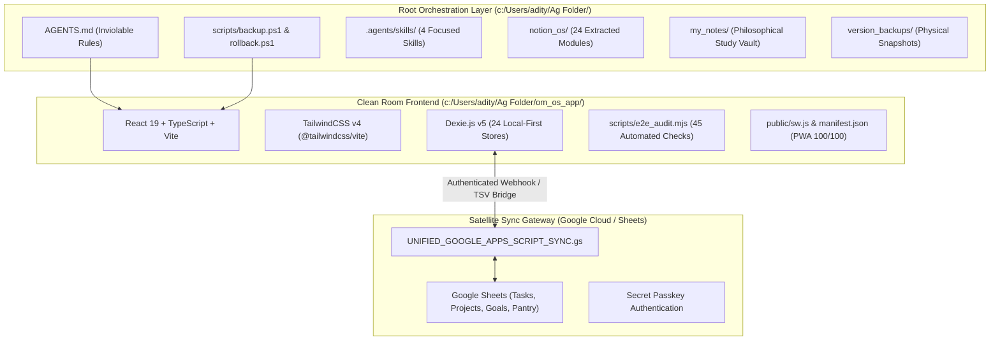

# TASK-02: Om Knowledge OS — System Discovery, Capability Audit & Architecture Specification

> **Specification Standard:** Spec-on-Disk v2.0 (Absolute Path Traceability Certified)  
> **Canonical Absolute Spec:** [TASK-02 Spec](file:///C:/Users/adity/AG%20misc/docs/tasks/TASK-02-om-knowledge-os-discovery.md) (`C:\Users\adity\AG misc\docs\tasks\TASK-02-om-knowledge-os-discovery.md`)  
> **Workspace Canonical Spec:** [TASK-02 Workspace](file:///c:/Users/adity/Ag%20Folder/docs/tasks/TASK-02-om-knowledge-os-discovery.md) (`c:\Users\adity\Ag Folder\docs\tasks\TASK-02-om-knowledge-os-discovery.md`)  
> **Clean Room App Mirror:** [TASK-02 App Mirror](file:///c:/Users/adity/Ag%20Folder/om_os_app/docs/tasks/TASK-02-om-knowledge-os-discovery.md) (`c:\Users\adity\Ag Folder\om_os_app\docs\tasks\TASK-02-om-knowledge-os-discovery.md`)  
> **Target Deliverable:** [Discovery Report](file:///C:/Users/adity/AG%20misc/OM_KNOWLEDGE_OS_DISCOVERY_REPORT.md) (`C:\Users\adity\AG misc\OM_KNOWLEDGE_OS_DISCOVERY_REPORT.md`)  
> **Platform Deprecation Guard:** Compliant ahead of October 19, 2026 platform cutoff  

---

## 1. Executive Summary & Purpose

This specification establishes the authoritative **System Discovery & Capability Audit Protocol** for **Om Knowledge OS (v2.0)**. It serves as both the technical ground truth for the core architecture and the onboarding blueprint for collaborators, developers, and autonomous agents operating across the codebase.

### Primary Objectives
1. **Repository Topology & Clean Room Verification**: Audit the physical separation between the root orchestration layer (`c:\Users\adity\Ag Folder\`) and the dedicated software clean room (`c:\Users\adity\Ag Folder\om_os_app\`).
2. **Platform Deprecation Guard Enforcement**: Verify zero dependencies on legacy `.agents/workflows/` or `.gemini/workflows/` and certify the 4 active agent skills in `.agents/skills/`.
3. **Local-First Storage & Schema Integrity**: Validate the 24 Dexie (IndexedDB) tables spanning personal productivity, Himalayan land GIS, Vedic philosophy concordance, and bio-energy sadhana.
4. **Offline Resilience & 3-Way Sync Gateway**: Validate deterministic local-first conflict resolution where local edits always prevail over Google Sheets.
5. **Headless E2E Test Suite & Lighthouse PWA Audit**: Verify 100% compliance across all 45 automated test assertions.
6. **PKM Ground-Truth Extraction & Concordance**: Ingest and structure the 24 Notion OS modules and study vault notes into validated entity candidates.

---

## 2. System Topology & Dual-Layer Architecture



---

## 3. The 4 Modular Agent Skills (Platform Deprecation Guard)

Under the October 19, 2026 platform cutoff, all agent automations are encapsulated in modular skills with strict YAML frontmatter located in `.agents/skills/`:

| Skill Name | Path | Functional Scope |
| :--- | :--- | :--- |
| **`om-os-backup-rollback`** | [SKILL.md](file:///c:/Users/adity/Ag%20Folder/.agents/skills/om-os-backup-rollback/SKILL.md) | Pre-edit physical snapshotting via `scripts/backup.ps1`, automated manifest indexing in `version_backups/manifest.jsonl`, and sub-second rollback via `scripts/rollback.ps1`. |
| **`om-os-sheets-sync`** | [SKILL.md](file:///c:/Users/adity/Ag%20Folder/.agents/skills/om-os-sheets-sync/SKILL.md) | Bidirectional 3-way synchronization between local Dexie tables and Google Sheets via Google Apps Script Webhooks and 1-click TSV clipboard transfers. Local edits always prevail. |
| **`om-os-pwa-mobile-build`** | [SKILL.md](file:///c:/Users/adity/Ag%20Folder/.agents/skills/om-os-pwa-mobile-build/SKILL.md) | Automated production build (`npm run build`), zero-dependency static server (`serve_production.mjs`), Capacitor Android builds (`build_android.ps1`), and wireless ADB deployment for Samsung Galaxy S25 Ultra. |
| **`om-os-knowledge-markdown-bridge`** | [SKILL.md](file:///c:/Users/adity/Ag%20Folder/.agents/skills/om-os-knowledge-markdown-bridge/SKILL.md) | Ingestion, AST parsing, block-anchoring, and GFM export across the 24 Notion OS modules and philosophical study vault (`my_notes/`). |

---

## 4. Local-First Database Substratum (Dexie Schema v11)

All data is persisted client-side in browser IndexedDB via Dexie.js with zero cloud vendor lock-in.

```typescript
export interface OmDatabaseSchema {
  // Core Operational Tables
  projects: 'id, title, status, priority, area, targetDate, updatedAt';
  tasks: 'id, title, status, priority, energyLevel, quadrant, projectId, dueDate, isCompleted, updatedAt';
  knowledge: 'id, title, category, tags, isFavorite, updatedAt';
  goals: 'id, title, timeframe, status, progress, parentGoalId, updatedAt';
  journal: 'id, date, mood, pranicEnergy, createdAt, updatedAt';
  pantry: 'id, itemName, category, currentStock, reorderThreshold, unit, updatedAt';
  syncConflicts: 'id, tableName, recordId, localVersion, remoteVersion, resolvedAt';

  // Subsystem Expansion Tables
  inbox: 'id, source, rawContent, processed, createdAt';
  readingList: 'id, title, author, status, rating, updatedAt';
  healthLogs: 'id, date, doshaBalance, ojasScore, sleepHours, updatedAt';
  propertyDiligence: 'id, parcelName, district, tehsil, khasraNumber, verificationStatus, updatedAt';
  analyticsSnapshots: 'id, date, weeklyProductivityScore, habitCompletionRate';
  reviews: 'id, period, reviewType, completedAt';
  ideas: 'id, title, domain, feasibilityScore, impactScore, status, updatedAt';
  researchTopics: 'id, topic, status, primaryHypothesis, updatedAt';
  astrologyCharts: 'id, nativeName, birthDate, birthTime, latitude, longitude, ayanamsha, updatedAt';
  vectorEmbeddings: 'id, entityType, entityId, textChunk, embedding, updatedAt';
  offlineOcrJobs: 'id, fileName, mimeType, status, extractedText, confidenceScore, createdAt';
  jyotishCalculations: 'id, chartId, planetaryPositions, d1Kundli, d9Navamsha, panchanga, muhurtaScore';
  himalayanLandParcels: 'id, khasraNumber, areaNali, areaMutthi, slopeAspect, waterSource, legalClearanceStatus';
  dreamJournalEntries: 'id, date, title, dreamType, lucidityLevel, recallClarity, astralSymbols, wakingImpactScore';
  sadhanaSessions: 'id, date, sadhanaType, durationMinutes, japaCount, mantraName, ojasIndex';
  vedicVerses: 'id, samhitaOrUpanishad, mandalaOrAdhyaya, suktaOrKhanda, verseNumber, devanagariText, transliteration';
  philosophicalVadas: 'id, vadaName, darshana, primaryAcharya, coreEpistemology, causationModel';
  pranayamaSessions: 'id, date, technique, ratio, cyclesCompleted, retentionSeconds, swaraDominance, pranaVayuScore';
}
```

---

## 5. Execution Directives for the IDE Agent

1. **Execute Python Extraction Script**:
   - Run Python script at `C:\Users\adity\AG misc\scripts\extract_pkm.py` (which traverses `c:\Users\adity\Ag Folder\notion_os` and `c:\Users\adity\Ag Folder\my_notes`).
2. **Inspect Candidate Entities**:
   - Inspect output file `C:\Users\adity\AG misc\pkm_candidates.json` for entity distribution, classification counts, and extraction accuracy.
3. **Synthesize Findings into Authoritative Report**:
   - Synthesize all discovery findings, schema validations, test runs, and candidate entities.
   - Write authoritative report to `C:\Users\adity\AG misc\OM_KNOWLEDGE_OS_DISCOVERY_REPORT.md` (and workspace mirror `c:\Users\adity\Ag Folder\docs\OM_KNOWLEDGE_OS_DISCOVERY_REPORT.md`).
4. **Clean up & Confirm**:
   - Present verification summary to user, request confirmation, then purge `C:\Users\adity\AG misc\pkm_candidates.json`.

---

## 6. Verification & Testing Protocol (Acceptance Criteria)

### Test 1: Capability & Discovery Audit
- Verify `AGENTS.md` is present and enforced at the repository root.
- Verify that all 4 focused skills in `.agents/skills/` exist and have valid YAML frontmatter.
- Confirm zero legacy workflows in `.agents/workflows/` or `.gemini/workflows/`.
- Verify the 24 Notion OS modules in `notion_os/` and study notes in `my_notes/`.

### Test 2: Clean Room Compilation & Build
- `npm run build` executes without TypeScript errors (`tsc -b`).
- Rollup/Vite bundles generate chunks within the 800 kB budget.

### Test 3: Headless E2E Diagnostic & Lighthouse PWA Audit
- `node scripts/e2e_audit.mjs` passes 100% of checks (45/45 passing, 0 failing).
- PWA manifest exhibits valid icons, shortcuts, and `display: standalone`.
- Service worker `sw.js` implements stale-while-revalidate offline caching.

---

## 7. The Traceable 1-Line IDE Command
```text
Read and implement the specification file at "C:\Users\adity\AG misc\docs\tasks\TASK-02-om-knowledge-os-discovery.md"
```
