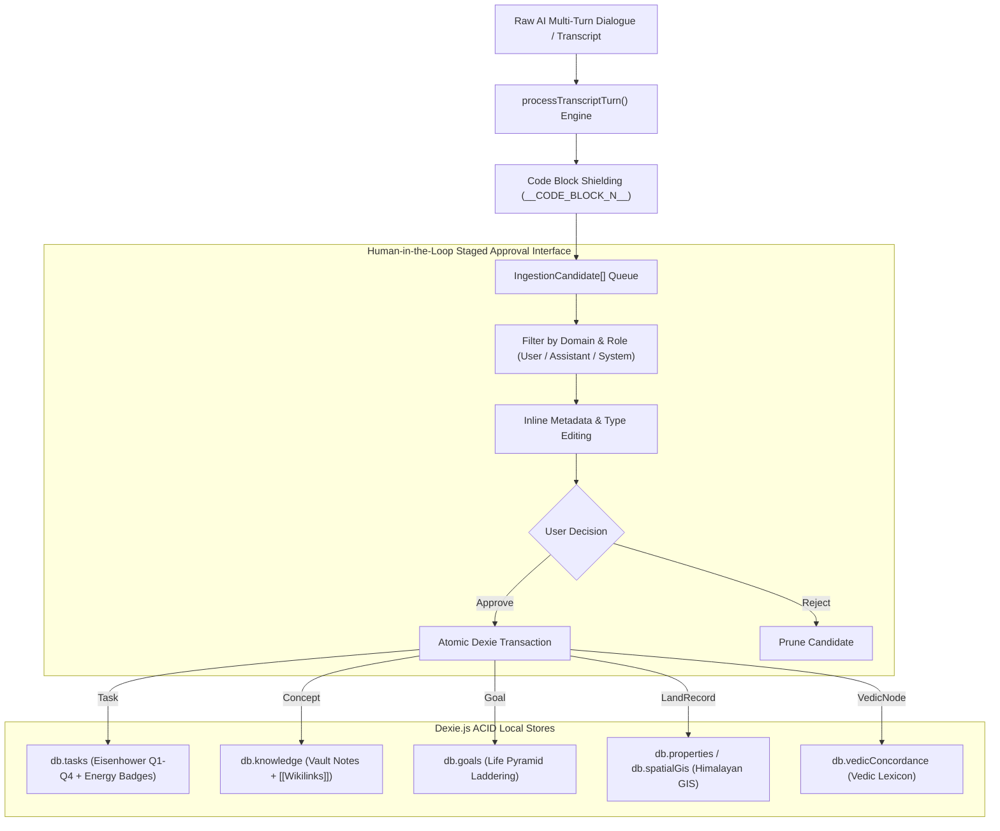

# TASK-19: Universal Inbox Human-in-the-Loop Staged Ingestion & Multi-Domain Entity Router (v2.0)

> **Specification Standard:** Spec-on-Disk v2.0 (Absolute Path Traceability Certified)  
> **Workspace Canonical Spec:** [TASK-19 Spec](file:///c:/Users/adity/Ag%20Folder/docs/tasks/TASK-19-UNIVERSAL-INBOX-STAGED-INGESTION.md) (`c:\Users\adity\Ag Folder\docs\tasks\TASK-19-UNIVERSAL-INBOX-STAGED-INGESTION.md`)  
> **Clean Room App Mirror:** [TASK-19 Clean Room Mirror](file:///c:/Users/adity/Ag%20Folder/om_os_app/docs/tasks/TASK-19-UNIVERSAL-INBOX-STAGED-INGESTION.md) (`c:\Users\adity\Ag Folder\om_os_app\docs\tasks\TASK-19-UNIVERSAL-INBOX-STAGED-INGESTION.md`)  
> **Milestone Alignment:** Phase 19 — Cognitive Refinery & Universal Ingestion Subsystem  
> **Target Substratum:** Dexie.js (IndexedDB Schema v11) + React 19 + TypeScript + Tailwind CSS v4 + Vite  

---

## 1. Executive Specification & Operational Intent

This specification upgrades the **Universal Inbox AI** (`src/components/UniversalInboxAI.tsx`) from basic task/note extraction into a full **Human-in-the-Loop Cognitive Refinery and Multi-Domain Entity Router**.

Following the architectural inflection established in [TASK-18](file:///c:/Users/adity/Ag%20Folder/om_os_app/docs/tasks/archive/TASK-18-STRATEGY-AND-PLAN-RECONCILIATION.md), raw AI transcripts (from ChatGPT multi-turn exports, Claude, or web research) contain heterogeneous knowledge types that must not be dumped into a single unstructured text field. Instead, the ingestion pipeline automatically tokenizes code blocks, extracts candidate entities via `processTranscriptTurn()`, and presents an interactive **Staging Drawer** where the user can inspect, adjust, and route each item across 5 foundational system domains:



---

## 2. 5-Way Domain Routing Specification

| Domain Route | Target Table | Extracted Fields & Enriched Metadata | Target View in Om OS |
| :--- | :--- | :--- | :--- |
| **Task** | `db.tasks` | `title`, `quadrant` (Q1-Q4), `urgency`, `impact`, `energyRequired`, `status: 'To Do'` | Task Intelligence Matrix |
| **Concept** | `db.knowledge` | `title`, `content` (markdown), `type: 'Concept' \| 'Note'`, `tags`, `[[wikilink]]` extraction | Knowledge Vault & 2D Graph |
| **Goal** | `db.goals` | `title`, `level` ('Quarterly OKR' \| '1-Year' \| '5-Year'), `lifeArea`, `status: 'Active'` | Goals Life Pyramid |
| **LandRecord** | `db.properties` | `title`, `location`, `status: 'Researching'`, `tags: ['Himalayan-Diligence']` | Property & Himalayan GIS |
| **VedicNode** | `db.vedicConcordance` | `title` (Sanskrit/Term), `content` (translation/commentary), `tags: ['Vedic-Corpus']` | Vedic Concordance View |

---

## 3. UI/UX Staged Approval Component Requirements

In `src/components/UniversalInboxAI.tsx`:
1. **Source & Role Selector Bar**:
   - Model switcher (`ChatGPT` | `Gemini` | `Claude` | `Web Note` | `Manual Transcript`).
   - Role filter toggles (`All`, `Assistant Only`, `User Prompts`).
2. **Batch Controls**:
   - `Select All (Approved)` / `Deselect All`.
   - `Commit Approved (N items)` button with live entity badge counters.
   - `Discard Unselected` action.
3. **Interactive Candidate Card**:
   - **Type Selector Dropdown**: 1-click switch between `Task`, `Concept`, `Goal`, `LandRecord`, `VedicNode`.
   - **Contextual Configs**:
     - When `Task`: Eisenhower Quadrant selector (`Q1` Urgent, `Q2` Deep Work, `Q3` Quick Win, `Q4` Low Priority).
     - When `Goal`: Life Area selector (`Spiritual`, `Health`, `Wealth`, `Career`, `Family`).
     - When `Concept`: Note type selector (`Concept`, `Note`, `Question`, `Quote`).
   - **Editable Title & Details**: Double-click or click-to-edit inline inputs.
   - **Relevance Score Badge**: Visual color-coded pill showing confidence score (`80%+` Emerald, `60-79%` Amber, `<60%` Gray).
4. **Atomic Multi-Table Transaction**:
   - Commits all approved candidates in a single ACID transaction across `db.tasks`, `db.knowledge`, `db.goals`, `db.properties`, `db.vedicConcordance`, and `db.inbox`.
   - Renders a post-commit toast reporting exact counts for each domain store.

---

## 4. Implementation Directives

1. **Import Contract**:
   Import `type IngestionCandidate` from `../db` and `processTranscriptTurn` from `../services/corpusIngestionEngine`.
2. **Replace Legacy Parser**:
   Update `handleParseConversation` in `UniversalInboxAI.tsx` to utilize `processTranscriptTurn()`, initializing candidates with `turnRole`, `score`, `suggestedType`, and full `extractedMetadata`.
3. **Multi-Table Atomic Transaction**:
   Extend `handleCommitStaged()` to support inserting into `db.goals`, `db.properties`, and `db.vedicConcordance` alongside `db.tasks` and `db.knowledge`.
4. **Automated Verification**:
   Update `scripts/e2e_audit.mjs` to assert `UniversalInboxAI` multi-domain candidate routing and transaction commit logic.

---

## 5. Verification Commands

```powershell
# Step 1: Type check and production build
npm --prefix "c:\Users\adity\Ag Folder\om_os_app" run build

# Step 2: Comprehensive Headless E2E & PWA Audit
npm --prefix "c:\Users\adity\Ag Folder\om_os_app" run audit
```

